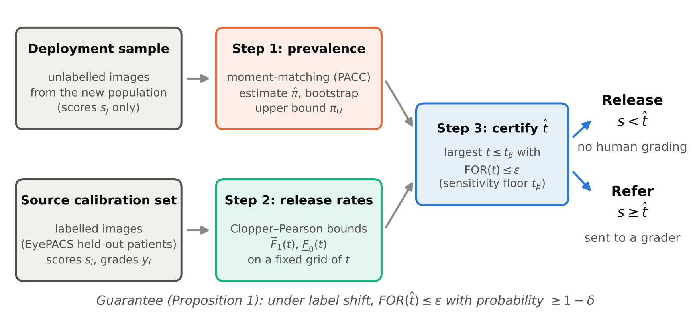

# PACR: prevalence-adaptive conformal rule-out for diabetic retinopathy screening

Code for the paper *Prevalence-adaptive conformal rule-out for diabetic retinopathy
screening: controlling the false-omission rate of automated triage under prevalence
shift* (under review).

In rule-out triage, a classifier releases the images it considers non-referable and only
the rest go to a human grader. Whether this is safe depends on the false-omission rate
(FOR) among the released images, and the FOR of a fixed threshold changes with the
prevalence of referable disease in the screened population. PACR estimates the
prevalence of a new population from unlabelled images and picks the largest release
threshold whose FOR is certified to stay below a target, with a minimum sensitivity.



## Main results

With a 2% FOR target (NPV ≥ 98%), a 90% sensitivity floor and 90% confidence:

- Fixed operating points and split, class-conditional and label-shift weighted conformal
  prediction exceeded the FOR target in 92–100% of repetitions once prevalence reached 10%
  (controlled label shift), and in 77–100% on the public cohorts at their native prevalence.
- PACR exceeded it in none of 3,800 repetitions (controlled shifts from 2% to 50% prevalence
  and four public cohorts at native, 10% and 5% prevalence).
- Under pure label shift PACR released 34% of images at 2% prevalence and 12% at 5%.
  On the external cohorts the prevalence was overestimated and PACR released nothing;
  200 labelled local images recovered 8–13% at 5% prevalence.

Full tables are in `results/tables/` and the figures in `figures/`.

## Installation

Python 3.10 or newer.

```bash
git clone https://github.com/MarwahZaidMohammedAl-Helali/pacr-dr-screening.git
cd pacr-dr-screening
pip install -r requirements.txt
```

A GPU is not needed; everything in the paper was run on a 2-core CPU.

## Data

All four datasets are public. The download script uses Hugging Face mirrors.

| Dataset | Images used | Source |
|---|---|---|
| EyePACS (Kaggle DR Detection) | 35,108 | [ctmedtech/EYEPACS](https://huggingface.co/datasets/ctmedtech/EYEPACS) |
| APTOS 2019 | 3,662 | [bumbledeep/aptos](https://huggingface.co/datasets/bumbledeep/aptos) |
| DDR | 12,522 gradable | [ctmedtech/DDR-dataset](https://huggingface.co/datasets/ctmedtech/DDR-dataset) |
| IDRiD (disease grading) | 516 | [amin-nejad/idrid-disease-grading](https://huggingface.co/datasets/amin-nejad/idrid-disease-grading) |

Please check and respect each dataset's licence; DDR is released under CC BY-NC-SA 4.0.

```bash
python scripts/download_data.py aptos idrid eyepacs ddr
```

DDR is about 15 GB at full resolution, so its images are downloaded one by one and
stored as 512 px crops. Set `PACR_DATA` to put the data somewhere else.

## Reproducing the paper

```bash
# 1. frozen DINOv2 ViT-S/14 features (about 2 h on a 2-core CPU, mostly EyePACS)
for d in eyepacs aptos ddr idrid; do python scripts/extract_features.py $d; done

# 2. classifier, all experiments (about 30 min)
python scripts/run_experiments.py

# 3. coverage of the prevalence bounds
python scripts/prevalence_coverage.py

# 4. tables and figures
python scripts/make_tables.py
python scripts/make_figures.py
python scripts/method_diagram.py
```

`run_experiments.py` takes the names of the experiments to run (`base controlled real
ncal eps`) and `--reps` for a quicker check, e.g. `--reps 20`.

## Using PACR with your own classifier

PACR only needs scores. Given calibration scores and labels from the population where
the model was developed, and scores of unlabelled images from the new population:

```python
import pacr

t_floor = pacr.class_conditional_threshold(s_cal, y_cal, alpha=0.10)      # 90% sensitivity
_, pi_upper = pacr.pacc_upper_bound(s_new, s_cal, y_cal, delta=0.05)
t = pacr.pacr_threshold(s_cal, y_cal, eps=0.02, delta=0.05, pi_upper=pi_upper, t_max=t_floor)

released = s_new < t   # t = -inf means nothing can be released safely
```

## Repository layout

```
pacr/                 the method
  prevalence.py       PACC, EM and BBSE prevalence estimators and bounds
  thresholds.py       PACR and the baseline release thresholds
  fundus.py           fundus cropping used for every dataset
scripts/              data download, feature extraction, experiments, tables, figures
results/tables/       LaTeX tables of the paper
figures/              figures of the paper
```


## License

MIT
